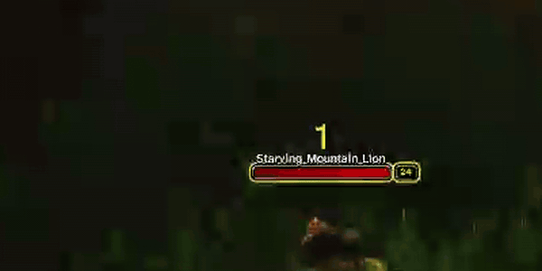

# ChunkHP

**Make every hit land.** When your target loses health, the lost piece flashes, hangs there for a moment, then drains away, like the health bars in fighting games and Soulslikes. It works on WoW Forever's own target frame and nameplates.

**[Download on CurseForge](https://www.curseforge.com/wow/addons/chunkhp)**

## Features

- **Hit flash.** The health that was just lost flashes white, so you see the size of every hit.
- **Draining trail.** A gold "ghost" of the lost health stays for a moment, then drains down to the real value.
- **Target frame and nameplates.** Turn each one on or off.
- **Five styles.** Pick Classic MMO, Soulslike, Fighting Game, JRPG or Arcade, or tune the timing yourself.
- **Live preview.** The options page shows a nameplate that looks like yours. Press Hit, Big hit or Heal, or turn on Auto, to see each change right away.
- **Damage number shortcuts.** Turn floating damage, damage-over-time and healing numbers on or off, and change their size where your client allows it.
- **No errors from secret health.** ChunkHP never reads or calculates health values, so Forever's protected health numbers can't break it.

## Install

Install it with the CurseForge app, or copy the `ChunkHP` folder into `World of Warcraft/_forever_/Interface/AddOns/` and restart the game.

## Settings

Open **Esc > Options > AddOns > ChunkHP**, or type `/chunkhp`.

| Command | What it does |
| --- | --- |
| `/chunkhp options` | Opens the settings page |
| `/chunkhp preset fighting` | Switches style (`classic`, `soulslike`, `fighting`, `jrpg`, `arcade`) |
| `/chunkhp delay 0.5` | Sets how long the trail waits before draining, in seconds |
| `/chunkhp fade 0.3` | Sets how long the flash takes to fade, in seconds |
| `/chunkhp target` · `nameplates` · `flash` · `trail` | Turns that part on or off |

## Compatibility

- WoW Forever, interface 16001 (build 1.60.1).
- In dungeons and raids, the game doesn't let addons change enemy nameplates, so only the target frame shows the effect there.

## Made with AI

Claude, an AI coding assistant, wrote most of ChunkHP's code under my direction, and I test it in game. If something breaks, please [open an issue](https://github.com/dmackerman/wow-addon-chunkhp/issues).

## Development

- Requirements, decisions and test status: [docs/REQUIREMENTS.md](docs/REQUIREMENTS.md) and [docs/IMPLEMENTATION-MATRIX.md](docs/IMPLEMENTATION-MATRIX.md).
- Release zips contain only the addon files (see `.pkgmeta`).

### Releasing

1. Set `## Version` in `ChunkHP.toc` and commit.
2. `git tag v1.5.1` and `git push origin v1.5.1`.

The [release workflow](.github/workflows/release.yml) builds the zip with the [BigWigs packager](https://github.com/BigWigsMods/packager), writes a changelog from the commits, and publishes it to GitHub and to CurseForge (project 1797146) as "ChunkHP v1.5.1". Tags containing `alpha` or `beta` are uploaded as Alpha or Beta files.
